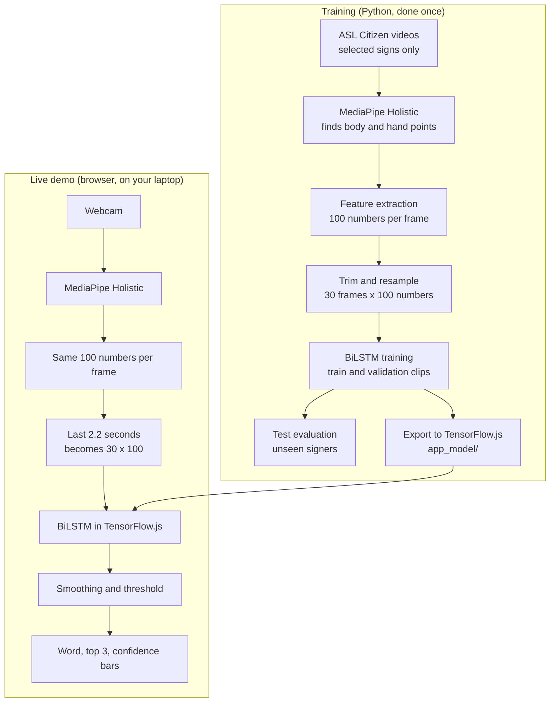

# Signo: a beginner's guide

This guide explains how Signo works using its real code, so you can explain and defend it in your viva. Read it from top to bottom once, then use the numbered sections for revision.

## The whole system in one picture



## 1. What problem is Signo trying to solve?

Most hearing people don't understand sign language, which creates a barrier for deaf and hard-of-hearing people in places like classrooms and hospitals. Signo takes a step towards closing that gap: you sign a word to a webcam and the word appears as text on screen.

## 2. What is sign-language recognition?

It means getting a computer to work out which sign a person made by watching them. Signo recognises American Sign Language (ASL) words from a fixed list. The default model knows 1,000 words (`python/vocab_asl_citizen_1000.txt`), and the fallback model knows 50 (`python/vocab_asl_citizen.txt`).

ASL is its own language, and it isn't the same as Indian Sign Language. Signo only knows ASL, so someone signing ISL won't be recognised correctly.

## 3. Isolated recognition vs continuous translation

- **Isolated recognition (what Signo does):** one sign at a time, chosen from a fixed list. Think of flashcards.
- **Continuous translation (what Signo does not do):** following natural signing, where signs flow together, and turning it into grammatical sentences. Think of a live interpreter.

The "Sentence" box in the app can be misleading. It only collects separate recognised words in order. It doesn't understand grammar, and it isn't translation.

## 4. What is MediaPipe Holistic?

MediaPipe Holistic is a ready-made model from Google. Show it one image and it tells you where a person's body and hands are. **We don't train it; we only use it.**

Signo uses it twice with the same settings: `new_holistic()` in `python/extract_wlasl.py` for the dataset videos, and `new Holistic(...)` in `index.html` for the webcam. Using the same settings in both places matters, because the live input should look like the training data.

## 5. What are landmarks and keypoints?

The two words mean the same thing here: a named point on the body, given as a position in the image. For example, landmark 15 is the left wrist. `x = 0.5, y = 0.3` means halfway across the image and 30% of the way down.

MediaPipe finds 33 body points and 21 points on each hand (the wrist plus 4 per finger). Signo keeps 7 of the body points: nose, both shoulders, both elbows and both wrists (`POSE_IDX` in `common.py`).

## 6. Why numbers instead of the raw video?

| | Raw video | Landmarks |
|---|---|---|
| Data per frame | 640 x 480 x 3 = 921,600 numbers | 100 numbers |
| Affected by clothes, room, skin tone, lighting | Directly | Much less, as long as MediaPipe finds the points |
| Training examples needed | Many more | Fewer |

We only have about 15 training clips per sign. A model working from raw pixels could easily learn the wrong things, such as "the person with the red shirt signs HELLO". Landmarks remove most of that distracting detail and leave just the movement.

The cost is that some information is lost. Without face landmarks, the model can't see facial expressions, which carry real meaning in ASL.

## 7. What is a feature vector?

It's a plain list of numbers describing one thing. In Signo, one video frame becomes one list of 100 numbers, built by `extract_features()` in `common.py`.

## 8. Why 30 frames?

A neural network like this one needs the same input size every time, but clips vary in length. A slow sign might have 120 frames and a fast one 40. So `to_seq()` always picks 30 evenly spaced frames. A 120-frame clip keeps about every fourth frame, and a 40-frame clip keeps most of them.

Thirty is enough to capture the shape of a movement while keeping the model small. Before resampling, `trim()` cuts away the parts where no hand is visible, keeping 2 extra frames on each side.

## 9. Why does each frame have 100 features?

| Part | Points | x and y each | Numbers |
|---|---|---:|---:|
| Upper body | 7 | x 2 | 14 |
| Left hand | 21 | x 2 | 42 |
| Right hand | 21 | x 2 | 42 |
| Is the left / right hand visible? (1 or 0) | | | 2 |
| **Total** | | | **100** |

**Why the coordinates aren't used directly.** A person standing near the camera looks bigger than one further away. A person on the left of the picture has different x values from one on the right. To make them comparable, every point is converted like this:

```python
f[k] = (p[i].x - cx) / sc   # cx = midpoint between the shoulders, sc = shoulder width
```

So a position now means "how far from the centre of the chest, measured in shoulder widths". Whoever you are and wherever you stand, your hand raised to your chin gives similar numbers.

**About the mirror.** The app shows your video flipped, like a mirror, but only with CSS (`transform: scaleX(-1)`). The model always gets the unflipped coordinates, the same as in training.

## 10. What is a BiLSTM?

An LSTM (Long Short-Term Memory) is a neural network layer that reads a sequence one step at a time and keeps a running memory. In Signo it reads frame 1, updates its memory, reads frame 2, updates again, and so on through frame 30.

BiLSTM means *bidirectional* LSTM. Signo's model (`build()` in `python/train.py`):

```text
Input: 30 frames x 100 numbers
  -> Bidirectional LSTM (48 memory units each way): reads the movement
  -> Dropout (30%): randomly switches off parts during training to prevent memorising
  -> Dense (48 neurons): combines what was learned
  -> Dense with softmax (1,000 or 50 outputs): one probability per sign, adding up to 100%
```

## 11. What does bidirectional mean?

There are two LSTMs. One reads frames 1 to 30, and the other reads frames 30 to 1. Their results are joined together.

Why bother? How a sign ends can help make sense of how it began. HELLO and SORRY finish in very different places, for example. A forward-only reader only learns the ending at the very end, whereas the backward reader starts with it.

## 12. How does it learn movement patterns?

Nobody writes a rule like "HELLO starts at the forehead". Learning goes like this:

1. The model starts with random internal numbers (weights), so its guesses are random.
2. It sees a clip and outputs one probability per sign.
3. The **loss** measures how wrong it was. Low probability for the correct sign means high loss.
4. An algorithm called Adam nudges all the weights slightly to reduce that loss.
5. Repeat thousands of times.

Over time, the weights come to respond to useful patterns, such as a hand moving away from the chin, or two hands repeatedly coming together. So it learns from the *change in position over time*, not from one frozen pose.

## 13. Training, validation and test sets

Think of a student preparing for an exam:

| Set | Analogy | Used for | Clips | Signers |
|---|---|---|---:|---:|
| Training | Textbook | Weights learn from these | 729 | 29 |
| Validation | Practice exam | Deciding when to stop and which version to keep | 186 | 5 |
| Test | Final exam | One honest score at the very end | 614 | 11 |

**The bug we fixed.** The original `train.py` mixed validation and test into one set, then used that set both to decide when to stop and to report the final score. That's like practising on the final exam and then quoting your mark. It makes the score look better than it should. Now `train.py` never scores test clips, and a separate `evaluate.py` does it and logs each attempt.

(These numbers are for the 50-sign model. The 1,000-sign model has 14,626 / 3,763 / 3,983 clips from 35 / 5 / 11 signers. The whole dataset has 35 / 6 / 11 signers, but not every signer recorded every word.)

**Why signer-independent matters.** The three sets contain completely different people (overlap measured as 0). So the test score answers the question "how well does it work on people it has never seen?", which is what happens when you use it yourself.

## 14. Epochs, loss, accuracy and overfitting

- **Epoch:** one full pass through the training data.
- **Loss:** how wrong the model is, with confidence taken into account. Lower is better. This is what training actually reduces.
- **Accuracy:** the percentage of clips where the top guess was right.
- **Overfitting:** the model memorises the training clips instead of learning general patterns. It looks like training accuracy rising while validation accuracy stalls and validation loss starts climbing.

**How Signo fights overfitting:** dropout, data augmentation, and early stopping. Early stopping means that if validation loss hasn't improved for 15 epochs, training stops and the best version is kept.

## 15. What is data augmentation?

It means creating slightly altered training copies. `augment()` in `common.py` makes 4 copies of each training clip, with random changes to:

- size (up to 10% either way)
- rotation (up to about 6 degrees either way)
- position (a small shift)
- each point (small random jitter, imitating MediaPipe's own noise)

It's like seeing the same sign from slightly different people and camera angles. It's only applied to **training** clips, because validation and test must stay real. Note that these copies are made from the numbers, so they aren't new real data, and we don't count them as extra clips.

## 16. Top-1 and top-5 accuracy

- **Top-1:** the model's first guess is correct.
- **Top-5:** the correct sign is somewhere in its five highest guesses.

If you sign HELP and the model ranks `please, help, sorry, more, want`, that counts as wrong for top-1 and right for top-5. Top-5 shows whether the model is "close", which is useful when many signs look alike.

For comparison, random guessing gets 2% top-1 and 10% top-5 among 50 signs, and 0.1% top-1 and 0.5% top-5 among 1,000 signs.

## 17. How does the trained model recognise a sign through a webcam?

All of this happens on your laptop. No video leaves the browser.

1. **Camera:** the browser gets webcam frames.
2. **Landmarks:** MediaPipe finds the points in each frame.
3. **Features:** `extract()` in `index.html` makes the same 100 numbers as Python. A test runs both versions and checks they match.
4. **Memory:** the app keeps the last 3 seconds of frames.
5. **Input:** about 5 times a second, it takes the last 2.2 seconds, trims them to where hands are visible, and resamples to 30 frames.
6. **Prediction:** the BiLSTM outputs one probability per sign.
7. **Smoothing:** the last 3 predictions are averaged to reduce flicker.
8. **Decision:** a word only appears if it's above the threshold (default 70%, the "Picky level" slider) and stays top for 2 checks in a row. Otherwise you see "Not sure yet". With no hands visible you see "No hands in view".

## How the files fit together

| File | What it does |
|---|---|
| `python/common.py` | The frozen feature spec. **Don't change it.** |
| `python/fetch_asl_citizen.py` | Downloads only the videos we need |
| `python/extract_asl_citizen.py` | Videos to 30 x 100 number grids |
| `python/train.py` | Trains the model using train and validation clips only |
| `python/evaluate.py` | Scores the chosen model on the test set and makes the figures |
| `python/export_tfjs.py` | Converts the model for the browser |
| `index.html` | The whole web app |
| `python/compare_runs.py` | Compares training runs using validation numbers only |
| `app_model_1000/`, `app_model/` | The 1,000-sign and 50-sign models the browser loads |
| `results_1000/`, `results/` | The real scores and figures for each model |

## What the real results mean (50-sign model)

| Measure | Validation | Test | Random guessing |
|---|---:|---:|---:|
| Top-1 | 82.3% | **76.7%** | 2% |
| Top-5 | 96.2% | **95.9%** | 10% |

- **Test is lower than validation.** That's normal: the model was chosen using validation, and they're different people. Test is the number to quote.
- **Top-5 is much higher than top-1.** When the model is wrong, the right sign is usually close behind.
- **It overfits.** Training accuracy reached about 99% while validation levelled off near 80%. That's why the model from epoch 27 was kept (lowest validation loss, 0.839) rather than the last one, where validation loss had risen to 1.401.
- **The browser matches Python.** On 50 held-out clips, the browser's prediction agreed with Python's on 48.
- **Confusions make sense.** The most common errors include stop read as school, and yes read as no. See `results/confusion_matrix.png`.

These numbers come from fluent signers in dataset videos. Your own webcam accuracy may be lower.

## What the real results mean (1,000-sign model)

| Measure | Validation | Test | Random guessing |
|---|---:|---:|---:|
| Top-1 | 69.5% | **61.4%** | 0.1% |
| Top-5 | 90.2% | **84.4%** | 0.5% |

- **Why is it lower than the 50-sign model's 76.7%?** It has 20 times as many signs to choose between, so there are many more ways to be wrong, but only about the same number of training clips per sign. It isn't a worse model. It's a harder exam.
- **Why did the smallest model win?** Bigger models have more memory, so they can memorise more. The 256-unit model reached 99.0% on training clips but only 66.9% on validation. The 48-unit model reached 92.3% and 69.5%. More units didn't help on people the model hadn't seen, at least within the 25 minutes they were given.
- **Why does validation loss rise while validation accuracy rises?** Loss also punishes overconfidence. As training goes on, the model gets more answers right, but it's very sure of its wrong answers too, and those cost a lot of loss. We wanted the most correct answers, so the final runs kept the epoch with the best validation accuracy.
- **What does the falling learning rate do?** The learning rate is the size of each weight nudge. Big nudges learn fast but can't settle, so the rate is halved whenever validation loss stops improving for 3 epochs.
- **Why be careful with single-sign scores?** Most signs have only 4 test clips, so one clip moves that sign's recall by 25%. Trust the overall score more than "family got 100%".
- **The threshold trade-off.** On validation clips, a 70% threshold shows a word for 75% of clips, and 81% of those are correct. At 90% it shows a word for 56% of clips, and 89% are correct. A pickier setting gives fewer words, but more of them are right.

## Version 2: why the model got better

| Model | Test top-1 before | Test top-1 after | Test top-5 before | Test top-5 after |
|---|---:|---:|---:|---:|
| 1,000 signs | 61.4% | **73.4%** | 84.4% | **92.0%** |
| 50 signs | 76.7% | **91.2%** | 95.9% | **97.6%** |

We didn't get better results by building a bigger network. We looked at the mistakes first.

**Problem 1: left-handed signers.** Most people sign with their right hand leading, and the model had mostly seen that. Left-dominant signers scored 46.7% and right-dominant signers 73.1%. It's like learning to read only one person's handwriting. **The fix is mirroring:** we flip half the training clips left to right, so the model also sees what left-handed signing looks like. Left-dominant signers now score 76.6%.

**Problem 2: memorising.** Version 1 made 4 fixed changed copies of each clip, and it saw them over and over. Imagine practising with the same 5 flashcards until you know their stains and creases rather than the words. **The fix is new random changes every epoch:** slightly different size, angle, position and speed each time. The model can't memorise a clip it never sees twice, so it has to learn the sign.

**Why is training accuracy lower now, if the model is better?** Training clips are now deliberately harder, because they change each time. Version 1 scored 92.3% on training clips and 69.5% on new people. One final member scores 83.9% and 78.0%. A smaller gap means less memorising, and the score on new people is the one that counts.

**More epochs.** With changing clips, the model keeps improving for longer: 72.2% at about 60 epochs and 78.0% at 180. The learning rate also slowly falls, like taking big steps towards a destination and then small careful ones.

**Averaging two models.** Two separately trained models make somewhat different mistakes. Averaging their probabilities cancels out some of those mistakes, taking validation from 78.0% to 79.4%. A third model reached 80.3%, but each prediction then took about 291 ms, over our 220 ms limit, so the app would lag. That's why we didn't use it.

**Why not 80% or more on 1,000 signs?** The model has only 11 to 17 real clips per sign, and some signs look very alike. Training on half the clips scored about 6.5 points lower, so more real clips should help most. The 50-sign model is easier: it has 20 times fewer signs to confuse, so it scores 91.2%.

**What does "second look" mean?** Each test set has now been scored twice, once per version. An exam is most trustworthy the first time you sit it, so these scores could be very slightly optimistic. We chose everything using validation data and changed nothing after seeing the scores, which keeps the effect small.

**What the 70% threshold does.** On validation clips, the 1,000-sign model shows a word for 69% of clips, and 93% of those are correct. For the rest it says "Not sure yet". This doesn't mean 93% accuracy overall. It means the app stays quiet when it's unsure.
