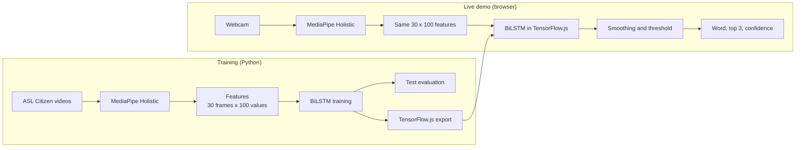

# Signo: word-level sign recognition from hands and upper-body pose

> **Update, version 4 (3 November 2026).** The default 1,000-sign model is now version 4: **83.2% top-1 and 96.4% top-5** on 8,134 official test clips never used before, against 74.1% and 92.6% for version 2 on the same clips. On the earlier 3,983 test clips it scored 83.8% and 96.6%, against 73.4% and 92.0%. It is one temporal convolution network plus one BiLSTM, with the same 30 x 100 input, and takes 68 ms per prediction in the browser against 116 ms. Real webcam accuracy still has not been measured. See `results/FINAL_RESULTS.md`. Older numbers below describe earlier versions.

Signo recognises isolated American Sign Language (ASL) words from a webcam, live in the browser. It ships with two main trained models: **1,000 signs (73.4% top-1 on unseen signers, the default)** and **50 signs (91.2% top-1 on unseen signers)**. The earlier version 1 models remain as fallbacks. MediaPipe Holistic finds hand and upper-body landmarks, and a BiLSTM classifies how they move over time. All processing happens on your device, and no video is uploaded.

**This is isolated sign recognition, not continuous sign-language translation.** It recognises one word at a time from a fixed vocabulary. It doesn't follow natural signing or produce grammatical sentences.

## Problem statement

Few hearing people understand sign language, which creates a communication barrier in places like classrooms and hospitals. Interpreters aren't always available. Much earlier computer-vision work focused on static fingerspelled letters, but most signing relies on movement.

## Objectives

1. Convert sign videos into normalised keypoint sequences using MediaPipe Holistic.
2. Train a temporal deep learning model to classify isolated signs from those sequences.
3. Evaluate with top-1 and top-5 accuracy and per-class precision and recall, then package the model as a real-time demo that shows the recognised sign as text.

### Differences from the original synopsis

| Topic | Synopsis | This implementation | Reason |
|---|---|---|---|
| Dataset | WLASL100 / WLASL300 | ASL Citizen subset | Individual videos can be fetched selectively, and it has an official split with no shared signers |
| Keypoints | Hand, face and body | Hand and upper body (the nose is the only face point) | The feature specification was frozen at 100 values per frame |

## Architecture



## Technologies

Python 3.11, TensorFlow 2.16 with tf_keras, MediaPipe 0.10.14, OpenCV, scikit-learn, TensorFlow.js 4.22, MediaPipe Holistic for JavaScript, and Playwright for browser tests.

## Feature extraction

Each frame becomes 100 numbers (`python/common.py`, mirrored in `index.html`):

| Part | Points | Values |
|---|---:|---:|
| Upper body: nose, shoulders, elbows, wrists | 7 | 14 |
| Left hand | 21 | 42 |
| Right hand | 21 | 42 |
| Left and right hand-present flags | | 2 |
| **Total** | | **100** |

Coordinates are centred on the shoulder midpoint and divided by shoulder width, so position and distance from the camera matter less. Clips are trimmed to where a hand is visible and resampled to 30 frames, giving the model an input of shape `(30, 100)`. A test runs the browser's JavaScript and the Python code on the same input and checks they match.

## Dataset

**ASL Citizen** (Microsoft Research), selectively downloaded with HTTP Range requests so the 45.9 GB archive never had to be fetched in full.

| | 1,000-sign model | 50-sign model |
|---|---:|---:|
| Clips selected / extracted | 22,421 / 22,372 | 1,535 / 1,529 |
| Failed extraction (too few hand frames) | 49 | 6 |
| Train / validation / test clips | 14,626 / 3,763 / 3,983 | 729 / 186 / 614 |
| Train / validation / test signers | 35 / 5 / 11 | 29 / 5 / 11 |
| Signers shared between splits | 0 | 0 |
| Training clips per sign | 11 to 17 | about 15 |

Both vocabularies were fixed before training and never chosen using accuracy (`python/vocab_asl_citizen.txt`, `python/vocab_asl_citizen_1000.txt`). The 1,000 signs are the 50 demo signs plus the most common English words among the dataset's signs, chosen by `python/make_vocab_1000.py`.

**One deliberate change to the split for 1,000 signs:** all official training and validation clips were kept, but the test split was capped at 4 clips per sign to save about 5 GB and 1.5 hours. Clips were picked by a hash of the file name, not by content. The split between signers is unchanged. Some signs have 3 test clips because extraction failed on the other.

### Licence and citation

ASL Citizen is under the Microsoft Research License Terms: non-commercial research use only.

- The videos and anything derived from them, including the extracted landmark files, must not be distributed. They are kept outside this repository.
- Publications and presentations must not include a substantial portion of the data, so **don't put dataset video frames in slides or reports**.
- The videos contain personal data. They must be **deleted, along with any backups, when the research is complete** (`rm -rf ~/signo_data`).
- The terms don't explicitly cover trained models. Check with your guide before publishing `app_model/`.

Cite: Desai et al. (2023), *ASL Citizen: A Community-Sourced Dataset for Advancing Isolated Sign Language Recognition*.

## Training methodology

- **Train:** the weights learn from these clips, plus 4 augmented copies of each (scale, rotation, shift, jitter).
- **Validation:** decides when to stop, which epoch to keep, and which model to use. The 50-sign model used validation loss. The 1,000-sign model used validation accuracy, for the reason given under Results.
- **Test:** scored only by `evaluate.py`, after the configuration is final. Each evaluation is logged in `test_log.json`, and repeats are refused by default.
- The official split is preserved. The original `train.py` merged validation and test into one set, which leaked test data into model selection. This is fixed, with a regression test.

**Version 2 (deployed).** Each member network is Input (30, 100), Bidirectional LSTM, Dropout (0.4), Dense (ReLU), Dropout (0.4), Softmax. Training clips get new random changes every epoch: mirroring, time warping, size, rotation, position, jitter and brief hand dropout. The learning rate follows a cosine curve, gradients are clipped, and the epoch with the best validation accuracy is kept (`python/train_plus.py`). The final models average two networks inside one TensorFlow.js model (`python/package_model.py`): two 128-unit networks for 1,000 signs (792,784 parameters), and a 128-unit and a 64-unit network for 50 signs (369,828 parameters).

**Version 1.** One network with 48 units and fixed augmented copies (`python/train.py`).

## Results

No run was repeated across enough seeds to report a mean or standard deviation. See [results/optimization_report.md](results/optimization_report.md), [results/error_analysis.md](results/error_analysis.md), [results/research_review.md](results/research_review.md), [results_1000_v2/results.md](results_1000_v2/results.md) and [results_50_v2/results.md](results_50_v2/results.md).

| Model | Signs | Val top-1 | Val top-5 | Test top-1 | Test top-5 | Test clips | Random guessing (top-1 / top-5) |
|---|---:|---:|---:|---:|---:|---:|---:|
| **Version 2** | 1,000 | 79.4% | 95.0% | **73.4%** | **92.0%** | 3,983 | 0.1% / 0.5% |
| **Version 2** | 50 | 95.2% | 98.4% | **91.2%** | **97.6%** | 614 | 2% / 10% |
| Version 1 | 1,000 | 69.5% | 90.2% | 61.4% | 84.4% | 3,983 | 0.1% / 0.5% |
| Version 1 | 50 | 82.3% | 96.2% | 76.7% | 95.9% | 614 | 2% / 10% |

The version 2 1,000-sign model's mean per-sign precision is 75.4%, recall 73.4% and F1 72.5%. The 50-sign model's are 91.7%, 91.3% and 91.1%. **Accuracy above 80% was not achieved on 1,000 signs.** Each test split has now been evaluated twice, once per version, so these scores may be slightly optimistic. All choices used validation data, and nothing was tuned after either score.

### Why version 2 is better

Error analysis showed that left-dominant signers scored 46.7% against 73.1% for right-dominant ones, and that version 1 was memorising its training clips (92.3% against 69.5%). New random changes every epoch, including mirroring, addressed both: left-dominant signers now reach 76.6% on validation. Longer training and averaging two models added the rest. Larger and graph models weren't given a fair amount of training on this CPU, so they aren't proven worse.

### Choosing the version 1 1,000-sign model

Six runs were compared using validation clips only. Round 1 kept the epoch with the lowest validation loss. In those logs validation accuracy kept rising after loss had turned upwards, so round 2 kept the epoch with the best validation accuracy and added a falling learning rate.

| Run | Units | Dropout | Epoch kept | Val top-1 | Val top-5 | Val loss | Train accuracy | Parameters |
|---|---:|---:|---:|---:|---:|---:|---:|---:|
| **Round 2, selected** | **48** | **0.3** | **29 of 39** | **69.5%** | **90.2%** | **1.618** | **92.3%** | **110,872** |
| Round 2 | 128 | 0.5 | 27 of 31 | 68.7% | 89.3% | 1.968 | 98.4% | 396,392 |
| Round 2 | 256 | 0.5 | 12 of 12 | 66.9% | 88.1% | 2.251 | 99.0% | 1,119,464 |
| Round 1 | 48 | 0.3 | 14 of 22 | 66.0% | 89.9% | 1.498 | 79.4% | 110,872 |
| Round 1 | 256 | 0.4 | 4 of 8 | 59.6% | 85.2% | 1.929 | 85.7% | 1,119,464 |
| Round 1 | 128 | 0.3 | 3 of 11 | 56.3% | 83.9% | 1.808 | 69.7% | 396,392 |

The selected model has the best validation top-1 and top-5, and it's the smallest. The larger models overfitted more among the round 2 runs. **This doesn't prove that larger models can't do better:** the 128-unit and 256-unit runs in round 2 hit a 25-minute time limit, and the 256-unit run's best epoch was its last one.

### Browser checks on the version 1 1,000-sign model

Not used to choose anything.

| Check | Result |
|---|---|
| TF.js vs Keras on 1,000 identical test sequences | Same top-1 and top-3 order on 1,000 of 1,000, largest probability difference under 0.000002 |
| Browser MediaPipe, features and model on 60 test videos | 65% top-1, 85% top-5 (Python: 65% top-1 on the same clips) |
| Browser prediction agrees with Python | 53 of 60 |
| Model switching and fallback | Labels and outputs stay matched when switching. If the 1,000-sign model is missing or corrupt, the app opens with the 50-sign model |
| Live app loop with dataset video as a pretend camera | Input length 3,000 (30 x 100). First pass through 8 clips in three runs: 6 right, 1 no word, 1 wrong; 5 right, 3 no word, 0 wrong; 5 right, 2 no word, 1 wrong. Six of the 8 signs were picked for good test results, so this checks that the loop works and isn't an accuracy score |

### Browser checks on version 2

Each TF.js model matched Python's top-1 and top-3 order on every test sequence checked (1,000 of 1,000 and 50 of 50).

| Check | 1,000 signs | 50 signs |
|---|---|---|
| Test videos through the browser | 60 clips: 76.7% top-1, 88.3% top-5 (Python 78.3%), same prediction on 55 | 50 clips: 90% top-1, 92% top-5 (Python 86%), same prediction on 46 |
| Prediction time, mean | 107-132 ms | 106-109 ms |
| Frames processed per second in the live loop | 4 to 11 | 12.5 |

With test clips as a pretend camera, the 1,000-sign model got 5 to 7 of 8 right over four runs, with at most one wrong word. The 50-sign model got 8 of 8 in one run, with one extra wrong word. This checks that the live loop works and isn't an accuracy score. MediaPipe and the model share the browser's main thread, so the full live cycle sometimes takes longer than 220 ms.

### Browser checks on the version 1 50-sign model

| Check | Result |
|---|---|
| TF.js vs Keras on identical sequences | Same top-1 and top-3 order on 50 of 50, largest probability difference under 0.000001 |
| Browser MediaPipe, features and model on 50 videos | 72% top-1, 92% top-5 (Python: 76% top-1 on the same clips) |
| Browser prediction agrees with Python | 48 of 50 |

These scores come from fluent signers in dataset videos. **Live webcam accuracy hasn't been measured for either model.**

## Install

Python 3.11 and Node are required.

```bash
python3.11 -m venv .venv
.venv/bin/pip install -r python/requirements.txt

# The TF.js converter needs its own environment
python3.11 -m venv .venv-tfjs
.venv-tfjs/bin/pip install tensorflow==2.16.2 tf_keras==2.16.0 "numpy<2" tensorflowjs==4.22.0
```

## Rebuild the model

```bash
M=~/signo_data/asl_citizen
# 1. Download the metadata (splits and licence) from the archive to $M/meta, then fetch the selected videos
.venv/bin/python python/fetch_asl_citizen.py --vocab python/vocab_asl_citizen.txt --meta $M/meta/ASL_Citizen \
    --out $M/videos --manifest $M/manifest.csv
# 2. Extract features (resumable)
.venv/bin/python python/extract_asl_citizen.py --manifest $M/manifest.csv --videos $M/videos --cache $M/features \
    --out $M/signo_dataset.json --report results/extraction_report.json --workers 6
# 3. Train
.venv/bin/python python/train.py --data $M/signo_dataset.json --out model_out/bilstm_seed0 --seed 0
# 4. Score the test set, only after the configuration is final
.venv/bin/python python/evaluate.py --run model_out/bilstm_seed0 --data $M/signo_dataset.json --results results
# 5. Export for the browser
.venv-tfjs/bin/python python/export_tfjs.py --run model_out/bilstm_seed0 --out app_model
```

The 1,000-sign model uses the same steps with `--vocab python/vocab_asl_citizen_1000.txt --test-per-class 4` when fetching, `manifest_1000.csv` and `signo_dataset_1000.json`, and these settings:

```bash
.venv/bin/python python/train.py --data $M/signo_dataset_1000.json --out model_out/w1000_u48_acc --seed 0 \
    --batch 64 --patience 10 --max-minutes 25 --select val_accuracy --reduce-lr --units 48 --lr 3e-3
.venv/bin/python python/evaluate.py --run model_out/w1000_u48_acc --data $M/signo_dataset_1000.json --results results_1000
.venv-tfjs/bin/python python/export_tfjs.py --run model_out/w1000_u48_acc --out app_model_1000 \
    --report results_1000/report.json --test-note "ASL Citizen test split, 4 clips per sign where available"
```

Version 2 uses `python/train_plus.py`, then `python/package_model.py`, and then the same evaluate and export steps. See `NOTES.md` for the exact settings.

Tests: `.venv/bin/python -m pytest python/tests -q`

## Run the app

```bash
python3 -m http.server 8000 --bind 127.0.0.1
```

Open http://localhost:8000 in Chrome. If you've opened the app before, press Cmd+Shift+R once to load the newest page. An internet connection is needed to load TensorFlow.js and MediaPipe from their CDN.

## Run the demo

1. Click **Wake up Signo!** and allow the camera.
2. Keep your head, shoulders and both hands in frame.
3. Sign one word at normal speed, then lower your hands.
4. Read the caption on the video and the top-3 bars. "Not sure yet" means confidence is below the Picky level slider.

The other tabs are still there: **Teach** to record your own signs, **Brain** to train in the browser and see reports, and **Challenge** for a 5-round game. Models you train in Teach are stored separately and don't replace the dataset models. Use the dropdown at the top to switch between **Large ASL model (1000 signs)**, **Accurate ASL model (50 signs)**, the two old models and your own. The app remembers a model you pick or train.

## Limitations

- **Signer variation:** accuracy varies between people, and the training set has few signers per word.
- **Small data:** 11 to 17 training clips per word. Training on half the clips scored about 6.5 points lower, so more real data should help.
- **Fixed vocabulary:** only the listed words can be recognised. Anything else gets forced into the closest one.
- **Coarse per-sign numbers:** the 1,000-sign test has at most 4 clips per sign, so each clip moves a sign's recall by 25%. The overall scores are more reliable than any single sign's score.
- **Limited experiments:** most comparisons used one seed and limited CPU time, and larger and graph models weren't trained fully.
- **Repeated test evaluation:** each test split has been evaluated twice.
- **Mirroring:** this could harm the few signs whose meaning depends on real left or right direction, which weren't tested separately.
- **Unfiltered vocabulary:** the 1,000 signs were chosen by word frequency and include some rude words, which can appear in the top-3 bars.
- **Camera position and lighting:** poor framing or light reduces landmark quality.
- **Hand detection failures:** fast movement or hands overlapping can lose landmarks.
- **No facial or non-manual features:** expressions carry meaning in ASL and aren't captured.
- **Dataset-to-webcam differences:** dataset signers are fluent, and live mode uses a sliding 2.2-second window while training used whole clips.
- **No "not signing" class:** the dataset has no such examples, so the app relies on hand visibility and the confidence threshold.

## Future improvements

Measured webcam accuracy, more training clips per word (WLASL is the realistic source), reviewing similar-looking sign labels, more seeds, fair training of larger models on a GPU, face landmarks, a "not signing" class, automatic sign start and end detection, graph or transformer models, and continuous recognition.
