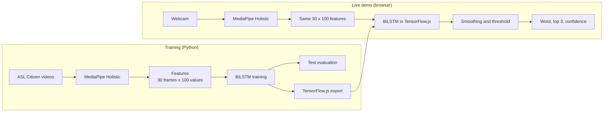

# Signo: word-level sign recognition from hands and upper-body pose

Signo recognises isolated American Sign Language (ASL) words from a webcam, live in the browser. MediaPipe Holistic finds hand and upper-body landmarks, and a BiLSTM classifies how they move over time. All processing happens on your device, and no video is uploaded.

**This is isolated sign recognition, not continuous sign-language translation.** It recognises one word at a time from a fixed vocabulary. It doesn't follow natural signing or produce grammatical sentences.

## Problem statement

Few hearing people understand sign language, which creates a communication barrier in places like classrooms and hospitals. Interpreters aren't always available. Much earlier computer-vision work focused on static fingerspelled letters, but most signing relies on movement.

## Objectives

1. Convert sign videos into normalised keypoint sequences using MediaPipe Holistic.
2. Train a temporal deep learning model to classify isolated signs from those sequences.
3. Evaluate with top-1 and top-5 accuracy and per-class precision and recall, then package the model as a real-time demo that shows the recognised sign as text.

### Differences from the original synopsis

| Topic | Synopsis | This implementation | Reason |
|---|---|---|---|
| Dataset | WLASL100 / WLASL300 | ASL Citizen subset | Individual videos can be fetched selectively, and it has an official split with no shared signers |
| Keypoints | Hand, face and body | Hand and upper body (the nose is the only face point) | The feature specification was frozen at 100 values per frame |

## Architecture



## Technologies

Python 3.11, TensorFlow 2.16 with tf_keras, MediaPipe 0.10.14, OpenCV, scikit-learn, TensorFlow.js 4.22, MediaPipe Holistic for JavaScript, and Playwright for browser tests.

## Feature extraction

Each frame becomes 100 numbers (`python/common.py`, mirrored in `index.html`):

| Part | Points | Values |
|---|---:|---:|
| Upper body: nose, shoulders, elbows, wrists | 7 | 14 |
| Left hand | 21 | 42 |
| Right hand | 21 | 42 |
| Left and right hand-present flags | | 2 |
| **Total** | | **100** |

Coordinates are centred on the shoulder midpoint and divided by shoulder width, so position and distance from the camera matter less. Clips are trimmed to where a hand is visible and resampled to 30 frames, giving the model an input of shape `(30, 100)`. A test runs the browser's JavaScript and the Python code on the same input and checks they match.

## Dataset

**ASL Citizen** (Microsoft Research), selectively downloaded with HTTP Range requests so the 45.9 GB archive never had to be fetched in full.

| | 50-sign model |
|---|---:|
| Clips selected / extracted | 1,535 / 1,529 |
| Failed extraction (too few hand frames) | 6 |
| Train / validation / test clips | 729 / 186 / 614 |
| Train / validation / test signers | 29 / 5 / 11 |
| Signers shared between splits | 0 |

The vocabulary was fixed before training and never chosen using accuracy. See `python/vocab_asl_citizen.txt`.

### Licence and citation

ASL Citizen is under the Microsoft Research License Terms: non-commercial research use only.

- The videos and anything derived from them, including the extracted landmark files, must not be distributed. They are kept outside this repository.
- Publications and presentations must not include a substantial portion of the data, so **don't put dataset video frames in slides or reports**.
- The videos contain personal data. They must be **deleted, along with any backups, when the research is complete** (`rm -rf ~/signo_data`).
- The terms don't explicitly cover trained models. Check with your guide before publishing `app_model/`.

Cite: Desai et al. (2023), *ASL Citizen: A Community-Sourced Dataset for Advancing Isolated Sign Language Recognition*.

## Training methodology

- **Train:** the weights learn from these clips, plus 4 augmented copies of each (scale, rotation, shift, jitter).
- **Validation:** early stopping on validation loss (patience 15) and choosing the best checkpoint.
- **Test:** scored only by `evaluate.py`, after the configuration is final. Each evaluation is logged in `test_log.json`, and repeats are refused by default.
- The official split is preserved. The original `train.py` merged validation and test into one set, which leaked test data into model selection. This is fixed, with a regression test.

Model: Input (30, 100), Bidirectional LSTM (48), Dropout (0.3), Dense (48, ReLU), Softmax. Adam, learning rate 0.003, batch 32, seed 0.

## Results

One training run with one seed, so there is no mean or standard deviation. Full details are in [results/results.md](results/results.md).

| Model | Signs | Val top-1 | Val top-5 | Test top-1 | Test top-5 | Test clips |
|---|---:|---:|---:|---:|---:|---:|
| BiLSTM | 50 | 82.3% | 96.2% | **76.7%** | **95.9%** | 614 |

Random guessing would score 2% top-1 and 10% top-5.

Browser check on 50 held-out clips, one per sign, not used to choose anything:

| Check | Result |
|---|---|
| TF.js vs Keras on identical sequences | Same top-1 and top-3 order on 50 of 50, largest probability difference under 0.000001 |
| Browser MediaPipe, features and model on the videos | 72% top-1, 92% top-5 (Python: 76% top-1 on the same clips) |
| Browser prediction agrees with Python | 48 of 50 |

These scores come from fluent signers in dataset videos. They are not a measurement of live webcam accuracy, which hasn't been measured.

## Install

Python 3.11 and Node are required.

```bash
python3.11 -m venv .venv
.venv/bin/pip install -r python/requirements.txt

# The TF.js converter needs its own environment
python3.11 -m venv .venv-tfjs
.venv-tfjs/bin/pip install tensorflow==2.16.2 tf_keras==2.16.0 "numpy<2" tensorflowjs==4.22.0
```

## Rebuild the model

```bash
M=~/signo_data/asl_citizen
# 1. Download the metadata (splits and licence) from the archive to $M/meta, then fetch the selected videos
.venv/bin/python python/fetch_asl_citizen.py --vocab python/vocab_asl_citizen.txt --meta $M/meta/ASL_Citizen \
    --out $M/videos --manifest $M/manifest.csv
# 2. Extract features (resumable)
.venv/bin/python python/extract_asl_citizen.py --manifest $M/manifest.csv --videos $M/videos --cache $M/features \
    --out $M/signo_dataset.json --report results/extraction_report.json --workers 6
# 3. Train
.venv/bin/python python/train.py --data $M/signo_dataset.json --out model_out/bilstm_seed0 --seed 0
# 4. Score the test set, only after the configuration is final
.venv/bin/python python/evaluate.py --run model_out/bilstm_seed0 --data $M/signo_dataset.json --results results
# 5. Export for the browser
.venv-tfjs/bin/python python/export_tfjs.py --run model_out/bilstm_seed0 --out app_model
```

Tests: `.venv/bin/python -m pytest python/tests -q`

## Run the app

```bash
python3 -m http.server 8000 --bind 127.0.0.1
```

Open http://localhost:8000 in Chrome. An internet connection is needed to load TensorFlow.js and MediaPipe from their CDN.

## Run the demo

1. Click **Wake up Signo!** and allow the camera.
2. Keep your head, shoulders and both hands in frame.
3. Sign one word at normal speed, then lower your hands.
4. Read the caption on the video and the top-3 bars. "Not sure yet" means confidence is below the Picky level slider.

The other tabs are still there: **Teach** to record your own signs, **Brain** to train in the browser and see reports, and **Challenge** for a 5-round game. Models you train in Teach are stored separately and don't replace the dataset model. Use the dropdown at the top to switch.

## Limitations

- **Signer variation:** accuracy varies between people, and the training set has few signers per word.
- **Small data:** about 15 training clips per word. Training accuracy reaches about 99% while validation levels off near 80%, which shows overfitting.
- **Small vocabulary:** only the listed words can be recognised. Anything else gets forced into the closest one.
- **Camera position and lighting:** poor framing or light reduces landmark quality.
- **Hand detection failures:** fast movement or hands overlapping can lose landmarks.
- **No facial or non-manual features:** expressions carry meaning in ASL and aren't captured.
- **Dataset-to-webcam differences:** dataset signers are fluent, and live mode uses a sliding 2.2-second window while training used whole clips.
- **No "not signing" class:** the dataset has no such examples, so the app relies on hand visibility and the confidence threshold.

## Future improvements

More training clips per word, more seeds, face landmarks, a "not signing" class, automatic sign start and end detection, graph or transformer models, and continuous recognition.
