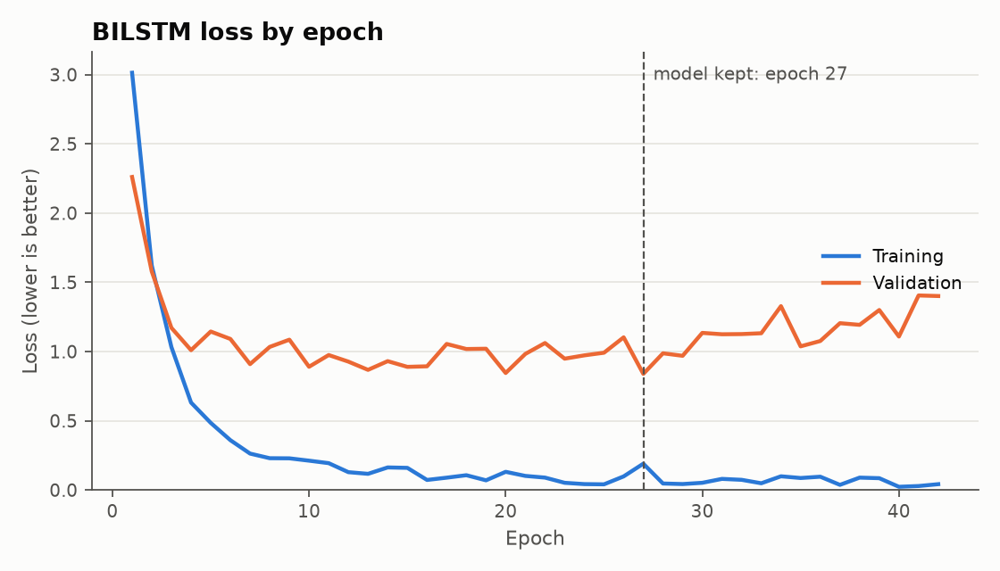
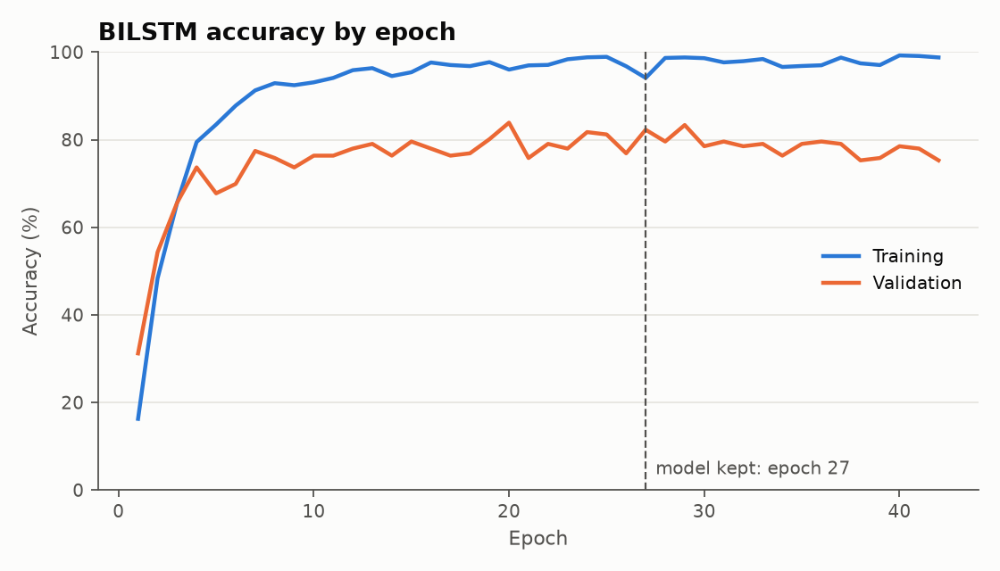
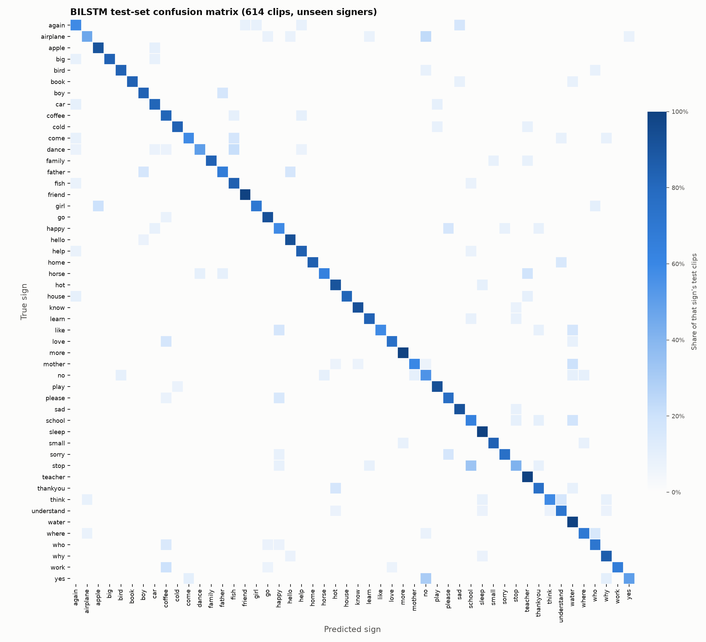

# Signo results: ASL Citizen, 50 signs

Generated from `report.json` by `python/write_results_md.py`. One training run (single seed), so no mean or standard deviation is reported.

| Measure | Validation | Test |
|---|---:|---:|
| Top-1 accuracy | 82.3% | **76.7%** |
| Top-5 accuracy | 96.2% | **95.9%** |
| Clips | 186 | 614 |
| Signers | 5 | 11 |

Random guessing would score 2.0% top-1 and 10.0% top-5. Mean per-class precision 79.3%, recall 76.7%.

## Setup

- **Dataset:** ASL Citizen, 50 signs. The official signer-independent split was used exactly as published.
- **Classes:** 50. **Clips:** 729 train, 186 validation, 614 test.
- **Signers:** 29 train, 5 validation, 11 test. Overlap between splits: 0.
- **Model:** bilstm, 48 units, dropout 0.3, Adam learning rate 0.003, batch 32, 64,322 parameters.
- **Training:** seed 0, 4 augmented copies per training clip, early stopping on validation loss with patience 15. Stopped at epoch 42, kept epoch 27, 26 s on CPU.
- **Extraction:** 1535 clips selected, 1529 extracted. Status counts: {'ok': 1529, 'no_hands': 6}.

## Figures

## Best signs on the test set

| Sign | Precision | Recall | F1 | Test clips |
|---|---:|---:|---:|---:|
| more | 92.3% | 100.0% | 96.0% | 12 |
| friend | 91.7% | 100.0% | 95.7% | 11 |
| know | 92.3% | 92.3% | 92.3% | 13 |
| home | 100.0% | 84.6% | 91.7% | 13 |
| big | 100.0% | 83.3% | 90.9% | 12 |
| book | 100.0% | 83.3% | 90.9% | 12 |
| family | 100.0% | 83.3% | 90.9% | 12 |
| house | 100.0% | 81.8% | 90.0% | 11 |
| play | 86.7% | 92.9% | 89.7% | 14 |
| apple | 83.3% | 90.9% | 87.0% | 11 |

## Worst signs on the test set

| Sign | Precision | Recall | F1 | Test clips |
|---|---:|---:|---:|---:|
| no | 40.0% | 54.5% | 46.2% | 11 |
| stop | 55.6% | 41.7% | 47.6% | 12 |
| happy | 50.0% | 58.3% | 53.8% | 12 |
| again | 50.0% | 58.3% | 53.8% | 12 |
| school | 50.0% | 63.6% | 56.0% | 11 |
| airplane | 75.0% | 46.2% | 57.1% | 13 |
| coffee | 47.4% | 81.8% | 60.0% | 11 |
| yes | 83.3% | 50.0% | 62.5% | 10 |
| dance | 87.5% | 50.0% | 63.6% | 14 |
| water | 52.2% | 100.0% | 68.6% | 12 |

## Most common confusions

| True sign | Predicted as | Clips |
|---|---|---:|
| stop | school | 4 |
| yes | no | 3 |
| work | coffee | 3 |
| mother | water | 3 |
| dance | fish | 3 |
| airplane | no | 3 |
| who | coffee | 2 |
| where | who | 2 |
| think | understand | 2 |
| thankyou | hot | 2 |

Per-class numbers for every sign are in `per_class_metrics.csv` and the raw matrix is in `confusion_matrix.csv`.

## The 1,000-sign model

The default model in the app is now the 1,000-sign model. Its full results are in [`results_1000/results.md`](../results_1000/results.md).

| Measure | Validation | Test |
|---|---:|---:|
| Top-1 accuracy | 69.5% | **61.4%** |
| Top-5 accuracy | 90.2% | **84.4%** |
| Clips | 3,763 | 3,983 |
| Signers | 5 | 11 |

Random guessing would score 0.1% top-1 and 0.5% top-5. Mean per-sign precision 65.0%, recall 61.5%. The test split was capped at 4 clips per sign.

### Model comparison (validation only)

| Run | Units | Dropout | Epoch kept | Val top-1 | Val top-5 | Val loss | Train accuracy | Parameters |
|---|---:|---:|---:|---:|---:|---:|---:|---:|
| **w1000_u48_acc (selected)** | 48 | 0.3 | 29 of 39 | 69.5% | 90.2% | 1.618 | 92.3% | 110,872 |
| w1000_u128_acc | 128 | 0.5 | 27 of 31 | 68.7% | 89.3% | 1.968 | 98.4% | 396,392 |
| w1000_u256_acc | 256 | 0.5 | 12 of 12 | 66.9% | 88.1% | 2.251 | 99.0% | 1,119,464 |
| w1000_u48 | 48 | 0.3 | 14 of 22 | 66.0% | 89.9% | 1.498 | 79.4% | 110,872 |
| w1000_u256 | 256 | 0.4 | 4 of 8 | 59.6% | 85.2% | 1.929 | 85.7% | 1,119,464 |
| w1000_u128 | 128 | 0.3 | 3 of 11 | 56.3% | 83.9% | 1.808 | 69.7% | 396,392 |

Runs ending in `_acc` kept the epoch with the best validation accuracy and lowered the learning rate as training stalled. The others kept the epoch with the lowest validation loss. The 128-unit and 256-unit `_acc` runs were stopped by a 25-minute limit.
