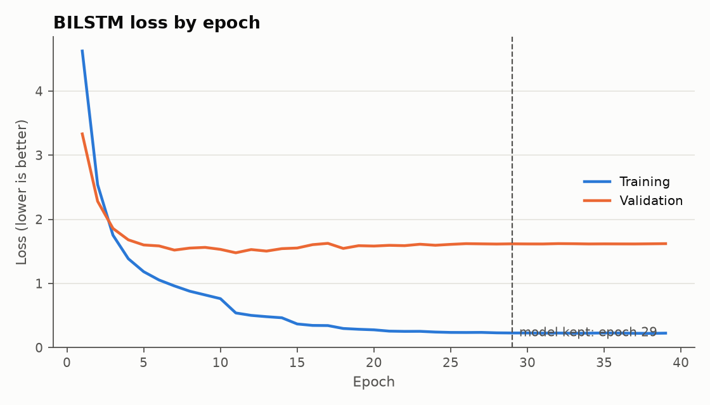
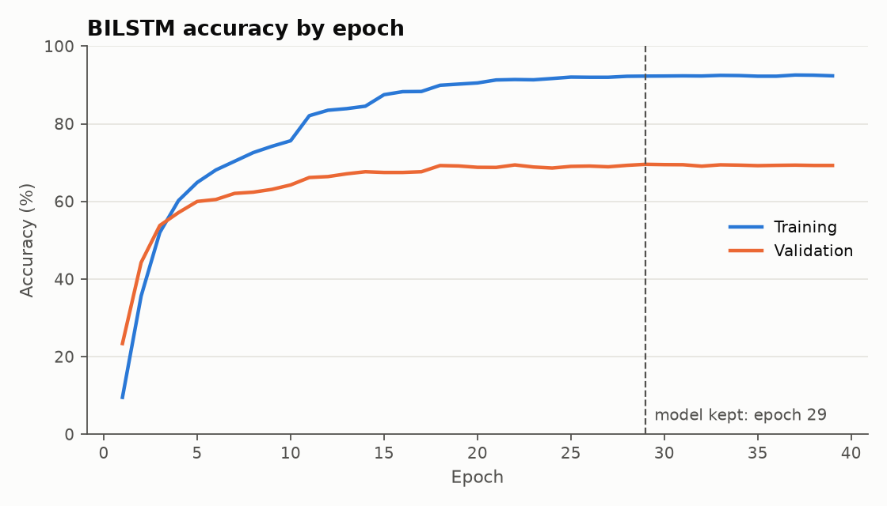
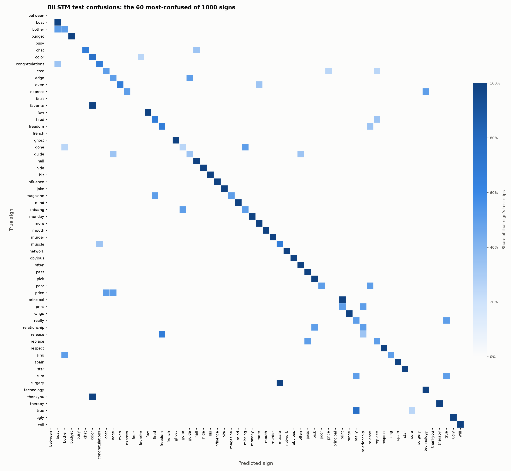

# Signo results: ASL Citizen, 1000 signs

Generated from `report.json` by `python/write_results_md.py`. One training run (single seed), so no mean or standard deviation is reported.

| Measure | Validation | Test |
|---|---:|---:|
| Top-1 accuracy | 69.5% | **61.4%** |
| Top-5 accuracy | 90.2% | **84.4%** |
| Clips | 3763 | 3983 |
| Signers | 5 | 11 |

Random guessing would score 0.1% top-1 and 0.5% top-5. Mean per-class precision 65.0%, recall 61.5%.

## Setup

- **Dataset:** ASL Citizen, 1000 signs. The official signer-independent split was kept. All train and validation clips were used, and the test split was capped at 4 clips per sign (picked by a hash of the file name). With so few clips per sign, many signs tie at 100% or 0%, so the best and worst lists below are examples from those ties, not a strict ranking.
- **Classes:** 1000. **Clips:** 14626 train, 3763 validation, 3983 test.
- **Signers:** 35 train, 5 validation, 11 test. Overlap between splits: 0.
- **Model:** bilstm, 48 units, dropout 0.3, Adam learning rate 0.003, batch 64, 110,872 parameters.
- **Training:** seed 0, 4 augmented copies per training clip, kept the epoch with the best val accuracy, patience 10, learning rate halved when validation loss stalled. Stopped at epoch 39, kept epoch 29, 887 s on CPU.
- **Extraction:** 22421 clips selected, 22372 extracted. Status counts: {'ok': 22372, 'no_hands': 49}.

## Figures

## Best signs on the test set

| Sign | Precision | Recall | F1 | Test clips |
|---|---:|---:|---:|---:|
| accident | 100.0% | 100.0% | 100.0% | 4 |
| any | 100.0% | 100.0% | 100.0% | 4 |
| april | 100.0% | 100.0% | 100.0% | 4 |
| award | 100.0% | 100.0% | 100.0% | 4 |
| away | 100.0% | 100.0% | 100.0% | 4 |
| ball | 100.0% | 100.0% | 100.0% | 4 |
| bedroom | 100.0% | 100.0% | 100.0% | 4 |
| boss | 100.0% | 100.0% | 100.0% | 4 |
| building | 100.0% | 100.0% | 100.0% | 4 |
| celebrate | 100.0% | 100.0% | 100.0% | 4 |

## Worst signs on the test set

| Sign | Precision | Recall | F1 | Test clips |
|---|---:|---:|---:|---:|
| true | 0.0% | 0.0% | 0.0% | 4 |
| to | 0.0% | 0.0% | 0.0% | 4 |
| think | 0.0% | 0.0% | 0.0% | 4 |
| thankyou | 0.0% | 0.0% | 0.0% | 4 |
| surgery | 0.0% | 0.0% | 0.0% | 4 |
| sure | 0.0% | 0.0% | 0.0% | 4 |
| suck | 0.0% | 0.0% | 0.0% | 4 |
| stop | 0.0% | 0.0% | 0.0% | 4 |
| sports | 0.0% | 0.0% | 0.0% | 4 |
| several | 0.0% | 0.0% | 0.0% | 4 |

## Most common confusions

| True sign | Predicted as | Clips |
|---|---|---:|
| haha | three | 4 |
| favorite | color | 4 |
| true | really | 3 |
| think | mind | 3 |
| stars | star | 3 |
| sit | chair | 3 |
| numbers | more | 3 |
| help | therapy | 3 |
| expect | loud | 3 |
| equal | even | 3 |

Per-class numbers for every sign are in `per_class_metrics.csv` and the raw matrix is in `confusion_matrix.csv`.

## Model comparison (validation only)

The model was chosen from this table before the test set was scored.

| Run | Units | Dropout | Kept epoch | Val top-1 | Val top-5 | Val loss | Train accuracy | Parameters | Minutes |
|---|---:|---:|---:|---:|---:|---:|---:|---:|---:|
| w1000_u48_acc | 48 | 0.3 | 29/39 | 69.5% | 90.2% | 1.618 | 92.3% | 110,872 | 14.8 |
| w1000_u128_acc | 128 | 0.5 | 27/31 | 68.7% | 89.3% | 1.968 | 98.4% | 396,392 | 25.0 |
| w1000_u256_acc | 256 | 0.5 | 12/12 | 66.9% | 88.1% | 2.251 | 99.0% | 1,119,464 | 25.0 |
| w1000_u48 | 48 | 0.3 | 14/22 | 66.0% | 89.9% | 1.498 | 79.4% | 110,872 | 7.7 |
| w1000_u256 | 256 | 0.4 | 4/8 | 59.6% | 85.2% | 1.929 | 85.7% | 1,119,464 | 17.8 |
| w1000_u128 | 128 | 0.3 | 3/11 | 56.3% | 83.9% | 1.808 | 69.7% | 396,392 | 9.4 |
