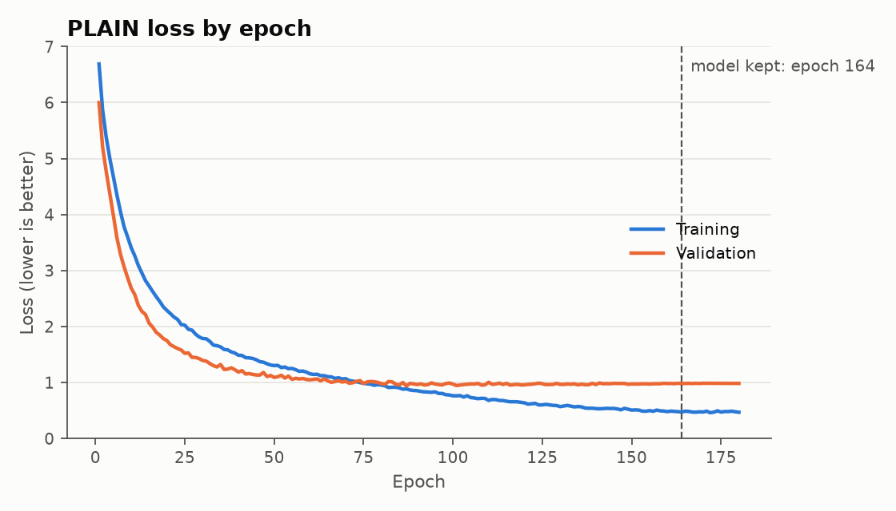
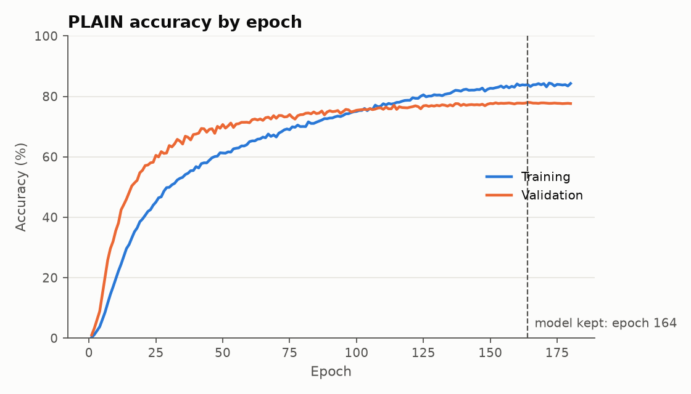
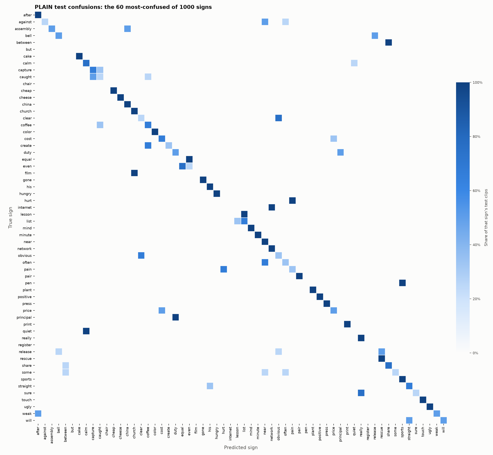

# Signo results: ASL Citizen, 1000 signs, version 2

Generated from `report.json` by `python/write_results_md.py`. One training run (single seed), so no mean or standard deviation is reported.

| Measure | Validation | Test |
|---|---:|---:|
| Top-1 accuracy | 79.4% | **73.4%** |
| Top-5 accuracy | 95.0% | **92.0%** |
| Clips | 3763 | 3983 |
| Signers | 5 | 11 |

Random guessing would score 0.1% top-1 and 0.5% top-5. Mean per-class precision 75.4%, recall 73.4%.

## Setup

- **Dataset:** ASL Citizen, 1000 signs, version 2. The official signer-independent split was kept, and the test split was capped at 4 clips per sign. This model combines two BiLSTM runs. This is the second logged evaluation of this test split. Per-sign numbers rest on very few clips, so many signs tie.
- **Classes:** 1000. **Clips:** 14626 train, 3763 validation, 3983 test.
- **Signers:** 35 train, 5 validation, 11 test. Overlap between splits: 0.
- **Model:** plain, 128 units, dropout 0.4, Adam learning rate 0.002, batch 64, 792,784 parameters.
- **Training:** seed 0, fresh every epoch augmented copies per training clip, kept the epoch with the best val accuracy, patience 0, learning rate halved when validation loss stalled. Stopped at epoch 180, kept epoch 164, 2292 s on CPU.
- **Extraction:** 22421 clips selected, 22372 extracted. Status counts: {'ok': 22372, 'no_hands': 49}.

## Figures

## Best signs on the test set

| Sign | Precision | Recall | F1 | Test clips |
|---|---:|---:|---:|---:|
| agency | 100.0% | 100.0% | 100.0% | 3 |
| airplane | 100.0% | 100.0% | 100.0% | 4 |
| alcohol | 100.0% | 100.0% | 100.0% | 4 |
| and | 100.0% | 100.0% | 100.0% | 4 |
| angry | 100.0% | 100.0% | 100.0% | 4 |
| any | 100.0% | 100.0% | 100.0% | 4 |
| anyone | 100.0% | 100.0% | 100.0% | 4 |
| april | 100.0% | 100.0% | 100.0% | 4 |
| asia | 100.0% | 100.0% | 100.0% | 4 |
| attention | 100.0% | 100.0% | 100.0% | 4 |

## Worst signs on the test set

| Sign | Precision | Recall | F1 | Test clips |
|---|---:|---:|---:|---:|
| true | 0.0% | 0.0% | 0.0% | 4 |
| think | 0.0% | 0.0% | 0.0% | 4 |
| thankyou | 0.0% | 0.0% | 0.0% | 4 |
| select | 0.0% | 0.0% | 0.0% | 4 |
| safe | 0.0% | 0.0% | 0.0% | 4 |
| rush | 0.0% | 0.0% | 0.0% | 4 |
| release | 0.0% | 0.0% | 0.0% | 4 |
| register | 0.0% | 0.0% | 0.0% | 4 |
| read | 0.0% | 0.0% | 0.0% | 4 |
| quiet | 0.0% | 0.0% | 0.0% | 4 |

## Most common confusions

| True sign | Predicted as | Clips |
|---|---|---:|
| quiet | calm | 4 |
| lesson | list | 4 |
| internet | network | 4 |
| but | different | 4 |
| wish | hungry | 3 |
| true | really | 3 |
| suspect | mind | 3 |
| sure | really | 3 |
| register | rule | 3 |
| race | sports | 3 |

Per-class numbers for every sign are in `per_class_metrics.csv` and the raw matrix is in `confusion_matrix.csv`.
