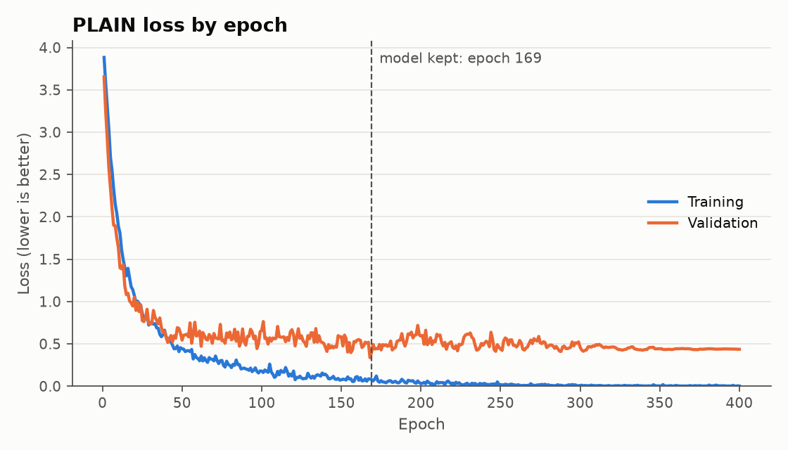
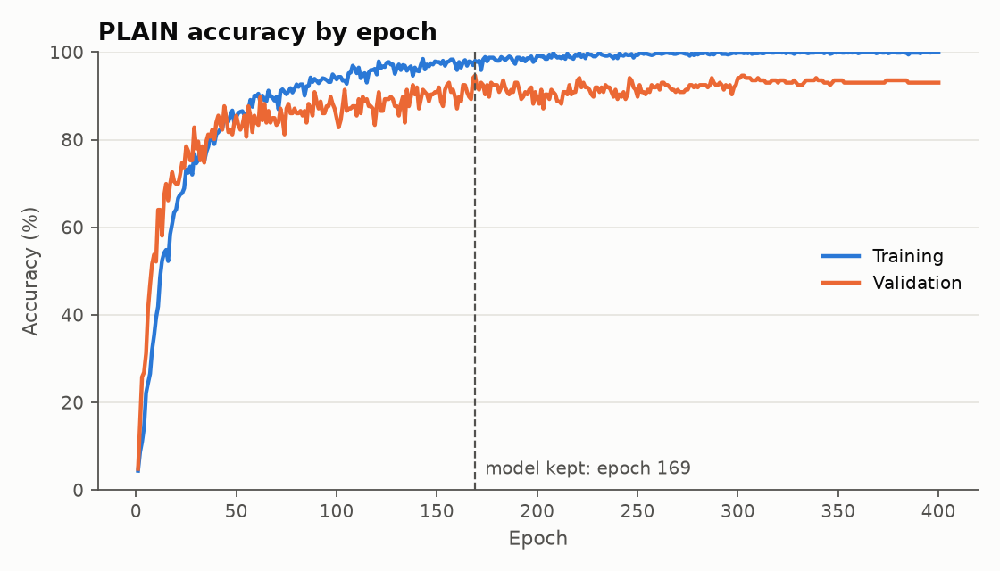
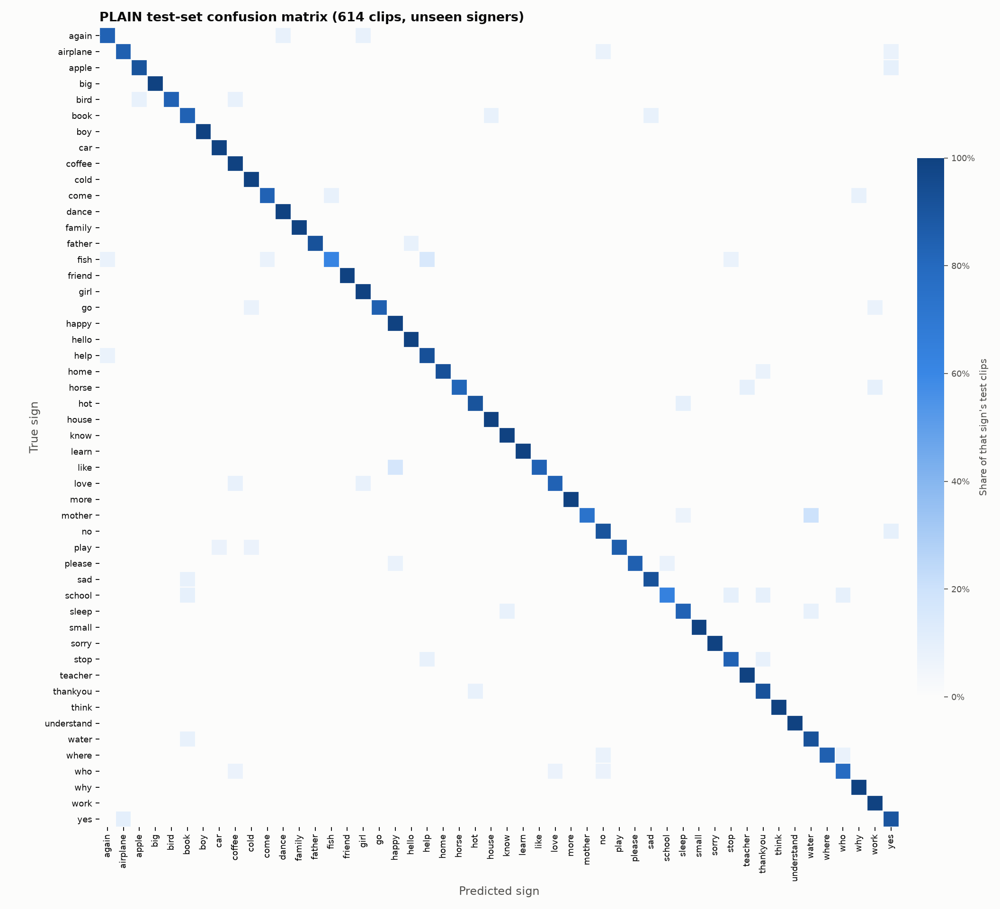

# Signo results: ASL Citizen, 50 signs, version 2

Generated from `report.json` by `python/write_results_md.py`. One training run (single seed), so no mean or standard deviation is reported.

| Measure | Validation | Test |
|---|---:|---:|
| Top-1 accuracy | 95.2% | **91.2%** |
| Top-5 accuracy | 98.4% | **97.6%** |
| Clips | 186 | 614 |
| Signers | 5 | 11 |

Random guessing would score 2.0% top-1 and 10.0% top-5. Mean per-class precision 91.7%, recall 91.3%.

## Setup

- **Dataset:** ASL Citizen, 50 signs, version 2. The official signer-independent split was used exactly as published. This model combines two BiLSTM runs. This is the second logged evaluation of this test split.
- **Classes:** 50. **Clips:** 729 train, 186 validation, 614 test.
- **Signers:** 29 train, 5 validation, 11 test. Overlap between splits: 0.
- **Model:** plain, 128 units, dropout 0.4, Adam learning rate 0.002, batch 32, 369,828 parameters.
- **Training:** seed 0, fresh every epoch augmented copies per training clip, kept the epoch with the best val accuracy, patience 0, learning rate halved when validation loss stalled. Stopped at epoch 400, kept epoch 169, 375 s on CPU.
- **Extraction:** 1535 clips selected, 1529 extracted. Status counts: {'ok': 1529, 'no_hands': 6}.

## Figures

## Best signs on the test set

| Sign | Precision | Recall | F1 | Test clips |
|---|---:|---:|---:|---:|
| big | 100.0% | 100.0% | 100.0% | 12 |
| boy | 100.0% | 100.0% | 100.0% | 12 |
| family | 100.0% | 100.0% | 100.0% | 12 |
| friend | 100.0% | 100.0% | 100.0% | 11 |
| learn | 100.0% | 100.0% | 100.0% | 12 |
| more | 100.0% | 100.0% | 100.0% | 12 |
| small | 100.0% | 100.0% | 100.0% | 12 |
| sorry | 100.0% | 100.0% | 100.0% | 12 |
| think | 100.0% | 100.0% | 100.0% | 12 |
| understand | 100.0% | 100.0% | 100.0% | 14 |

## Worst signs on the test set

| Sign | Precision | Recall | F1 | Test clips |
|---|---:|---:|---:|---:|
| fish | 88.9% | 61.5% | 72.7% | 13 |
| school | 87.5% | 63.6% | 73.7% | 11 |
| book | 76.9% | 83.3% | 80.0% | 12 |
| who | 84.6% | 78.6% | 81.5% | 14 |
| water | 73.3% | 91.7% | 81.5% | 12 |
| yes | 75.0% | 90.0% | 81.8% | 10 |
| stop | 83.3% | 83.3% | 83.3% | 12 |
| sleep | 83.3% | 83.3% | 83.3% | 12 |
| again | 83.3% | 83.3% | 83.3% | 12 |
| no | 76.9% | 90.9% | 83.3% | 11 |

## Most common confusions

| True sign | Predicted as | Clips |
|---|---|---:|
| mother | water | 3 |
| like | happy | 2 |
| fish | help | 2 |
| yes | airplane | 1 |
| who | no | 1 |
| who | love | 1 |
| who | coffee | 1 |
| where | who | 1 |
| where | no | 1 |
| water | book | 1 |

Per-class numbers for every sign are in `per_class_metrics.csv` and the raw matrix is in `confusion_matrix.csv`.
